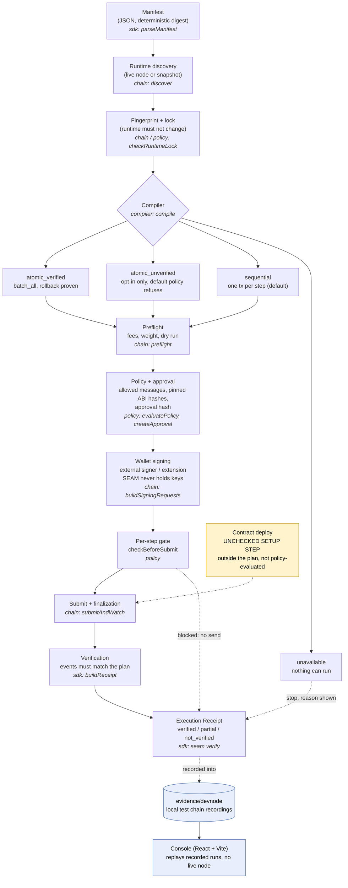
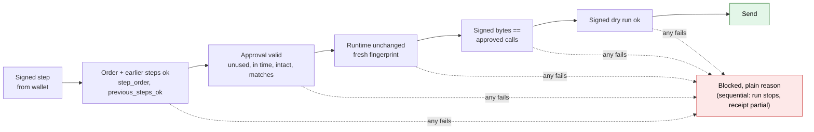

# SEAM architecture

> **Evidence scope:** two local chains were used: a `substrate-contracts-node` dev chain and a local Portaldot dev node (spec 1002). Neither is the hosted Portaldot V3 testnet or mainnet, and local success does not show V3 or Revive support. Portaldot mainnet is only read (snapshot). Nothing has been submitted to the V3 testnet or mainnet.

## Pipeline

Images for slides and the README: [architecture.png](img/architecture.png), [architecture.svg](img/architecture.svg). Mermaid sources: `docs/img/*.mmd`.

**In plain words.** A developer writes a Manifest. SEAM reads the live runtime, fingerprints it and locks it, then the compiler builds exact calls from the chain's own metadata and picks a plan mode: `atomic_verified`, `atomic_unverified` (opt-in only), `sequential` (the default), or `unavailable` when the runtime can't do it. A preflight estimates fees and dry-runs, then the policy checks allowed messages, pinned ABI hashes and limits, and the approval hash binds everything together. The user's external wallet signs; SEAM never holds keys. Right before each step is sent, the gate re-checks the approval, the runtime and the signed bytes. After finalization, SEAM checks that the on-chain events match the plan and produces a Receipt. The contract deploy used by the demo is a one-time **unchecked setup step** that sits outside the plan and is not evaluated by policy. The console doesn't talk to a node: it replays recorded runs from `evidence/devnode`.

| Stage | Package |
| --- | --- |
| Manifest | `packages/sdk` (`parseManifest`) |
| Discovery, fingerprint, preflight, signing handoff, submit and track | `packages/chain` |
| Compile and plan modes | `packages/compiler` |
| Policy, approval, runtime lock, submit gate | `packages/policy` |
| Receipt, explanations, `seam` CLI | `packages/sdk` |
| Walkthrough UI | `packages/console` |

## Per-step submit gate

Gate check codes and block reasons: [reference.md](reference.md#submit-gate-block-reasons). Image: [gate.png](img/gate.png).
