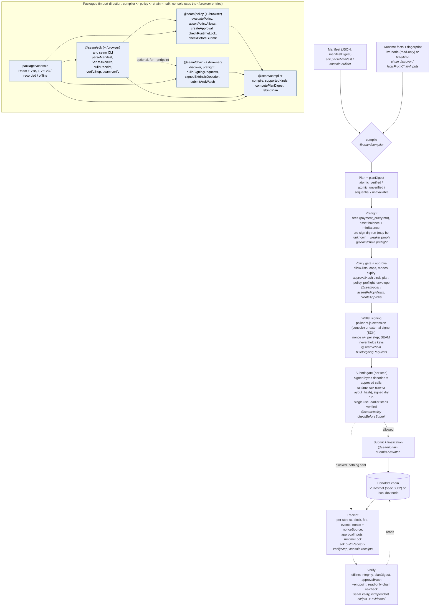
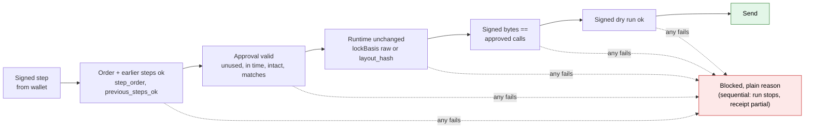

# SEAM architecture

> **Evidence scope:** the hosted Portaldot V3 testnet (spec 3002) has finalized SEAM runs, each indexed with its verification file in [evidence-manifest.md](evidence-manifest.md): the funded run of 2026-10-19 (18 transactions, local keystore signer) and later console runs signed through the polkadot.js extension (#118310, #119634, #119996, #120936, #121390/#121394). Local chains (a `substrate-contracts-node` dev chain and a local Portaldot dev node, spec 1002) are recorded separately and show nothing about V3. Not shown anywhere: a per-call Revive effect, a fresh account mapping, ink!/PolkaVM on V3, or cross-VM atomicity. Portaldot mainnet is only read (snapshot); nothing has been submitted to it.

## Pipeline

Images for slides and the README: [architecture.png](img/architecture.png), [architecture.svg](img/architecture.svg). Mermaid sources: `docs/img/*.mmd`. The package edges follow the real `import` statements in `packages/*/src` (on `7a551e3`): policy imports only `@seam/compiler/browser`; chain imports only the compiler; the SDK imports compiler and policy and loads `@seam/chain` dynamically for `--endpoint`; the console imports the `*/browser` entries of all four.

**In plain words.** A Manifest (written by hand, by the SDK, or in the console's Manifest Builder) is compiled against runtime facts read from the live node or a snapshot. The compiler builds exact calls from the chain's own metadata and picks a plan mode: `atomic_verified`, `atomic_unverified` (opt-in only), `sequential` (the default), or `unavailable`. The plan has a deterministic `planDigest`. Preflight estimates fees, checks the signer's asset balance against the asset's `minBalance` for `assets.transfer`, and reports a pre-sign dry run, which may be `unknown` (allowed only as weaker proof). The policy gate then runs fail-closed right before the wallet, and `createApproval` binds plan, policy, preflight and signing envelope into one `approvalHash`. The user's wallet signs (the console uses the polkadot.js extension; SEAM never holds keys), one transaction per step with nonce `n + i`. Before each send, `checkBeforeSubmit` decodes the signed bytes and compares them with the approved calls, re-checks the runtime lock (`lockBasis` `raw`, or `layout_hash` when only the raw metadata hash drifted and the layout is unchanged), requires the signed dry run, enforces single use and stops a sequential run unless every earlier step is finalized and verified. The receipt records what the chain shows; `seam verify` and the independent scripts behind `evidence/` re-check it. A Revive contract deploy done as a setup script (as at #102843) stays an **unchecked setup step** outside policy; the compiler's `revive.instantiate_with_code` kind is policy-checked (code-hash allow-list), but no deploy through policy has been run on V3.

| Stage | Package |
| --- | --- |
| Manifest | `packages/sdk` (`parseManifest`) |
| Discovery, fingerprint, preflight (incl. balance/`minBalance`), signing requests, signed-extrinsic decoding, submit and track | `packages/chain` |
| Compile and plan modes | `packages/compiler` |
| Policy, approval, runtime lock, submit gate | `packages/policy` |
| Receipt, explanations, `seam` CLI | `packages/sdk` |
| LIVE V3 signing, recorded and offline modes | `packages/console` |

## Per-step submit gate

Gate check codes and block reasons: [reference.md](reference.md#submit-gate-block-reasons). Image: [gate.png](img/gate.png).
