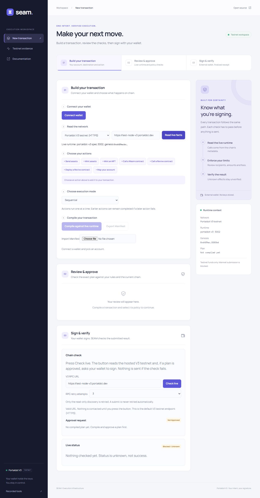

# Zero-warning cleanup and testnet app deployment

Completed 3 November 2026, Asia/Calcutta.

## Live app

- [Live workspace](https://seam-portaldot.vercel.app/console.html)
- [Landing page](https://seam-portaldot.vercel.app/)
- [Immutable deployment](https://seam-portaldot-dw8iw9mjh-rishu4436s-projects.vercel.app/console.html)
- Vercel deployment: `dpl_8swhdLM9p6UNRDpGJyh9pZ248UQt`, ready, production hosting target.

Production here describes website hosting. Transaction execution remains restricted to the hosted Portaldot V3 testnet; mainnet submission remains blocked.

The existing Vercel project was used. The locally built static assets were packaged using Build Output API v3 and deployed with `vercel deploy --prebuilt --prod --yes`. Only the static build was uploaded. No wallet credentials, environment files or research documents were included. No Git commit or push was performed; the deployed artifacts reflect the current working tree, based on `7178830`.

All **40 deployed files** returned HTTP 200 and their SHA-256 hashes exactly matched the checked local build. A subsequent package-smoke rebuild produced the same assets. The retained [build verification manifest](deployment-build-2026-11-03.json) identifies the exact artifact hashes.

## Lint cleanup

All 158 previously reported warnings were resolved: 141 broad `any` annotations/casts, 11 unused values/imports, three unused expressions and three fallthrough warnings.

- Runtime code uses the Polkadot codec, runtime, signing and contract-result types.
- File-store JSON starts as `unknown` and is narrowed before records are used.
- Fixtures and test helpers use the relevant plan, signing, gate, receipt and evidence shapes. Deliberately malformed parser inputs cross an explicit `unknown` boundary.
- Unused imports/values were removed and conditional side effects were replaced with explicit branches.
- Unsupported ink! type paths now throw explicitly rather than appearing to fall through.

The affected lint rules are errors, and `npm run lint` now enforces `--max-warnings 0`. No lint rule was disabled to obtain the result.

## Verification after cleanup

| Check                      | Result                                                                   |
| -------------------------- | ------------------------------------------------------------------------ |
| Root lint                  | **Zero errors, zero warnings**                                           |
| Formatting                 | Passed                                                                   |
| Production build           | Passed on Windows and Ubuntu/WSL                                         |
| Compiler                   | 359 passed                                                               |
| Policy                     | 452 passed                                                               |
| SDK                        | 472 passed                                                               |
| Chain                      | 390 passed, 13 opt-in skips                                              |
| Console                    | 287 passed                                                               |
| Workspace total            | **1,960 passed, zero failures, 13 skips**                                |
| Disposable Linux-chain E2E | Three passed: setup, sequential execution, rollback/atomic follow-up     |
| Quickstart                 | 20 commands passed, nine documented skips, zero failures                 |
| Packed consumer/CLI smoke  | Passed                                                                   |
| npm audit                  | Zero advisories                                                          |
| Evidence manifest          | 83 hashes match                                                          |
| API reference              | Matches real exports                                                     |
| Diff whitespace            | Passed                                                                   |
| Hosted asset verification  | 40 files match the checked build exactly                                 |
| Hosted browser check       | Landing/workspace loaded; live V3 discovery succeeded; no browser errors |

The opt-in local-chain cases were run separately through the E2E harness. Its node and temporary Linux checkout were cleaned up. Tests do not constitute a formal security audit.

## Wallet rehearsal

The hosted app read `portaldot-v3`, spec 3002, with genesis starting `0xd4f9acbc`, and displayed all seven supported action kinds. This verifies the deployed-origin network read and metadata discovery. No user wallet was connected, and no fresh public-testnet transaction was signed or broadcast by this validation.

For the first complete rehearsal:

1. Open the live workspace in a desktop browser with the Polkadot.js wallet extension available and authorize the app to read the intended account.
2. Use a testnet account with native tPOT for fees. For **Send assets**, also use a known asset ID and a balance owned by that account; native tPOT alone is insufficient for an Assets transfer.
3. Read the live network, choose the action, enter the recipient and amount in base units, compile, then select the policy and review its checks.
4. Approve the reviewed plan. In **Sign & verify**, use **Check live** to perform the final checks and request the wallet signature. Confirm only the intended testnet operation in the wallet.
5. Wait for the finalized result. Save the receipt and transaction hash, and independently verify the result against the chain. Also rehearse rejecting a wallet request and changing a recipient after approval.

Participant testnet funding instructions are on the [official event page](https://dorahacks.io/hackathon/portaldot-hacker-house-2026/detail). They describe organizer distribution through Discord, rather than a public faucet.

