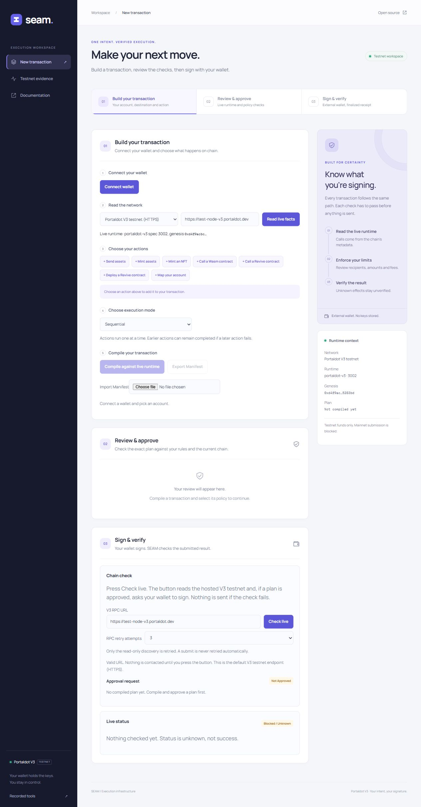

# Security fixes and live testnet workspace

Follow-up on 3 November: the remaining 158 lint warnings were resolved and the app was deployed. See the [current deployment and verification report](deployment-2026-11-03.md). The results below describe the initial remediation stage.

The actionable findings in the [2 November audit](analysis-2026-11-02.md) have been addressed in the working tree. The console now opens directly into a redesigned live-testnet workspace. Validation continued on 3 November 2026. The original audit is retained as a historical record.

## Security changes

- Policy results are bound to immutable snapshots of their contents, plan, policy, preflight and runtime inputs. Reusing an allowed result for a disallowed plan, editing it in place or changing its preflight blocks approval/submission.
- Sequential receipt steps must identify distinct transactions in order. Duplicate action IDs and reused extrinsics are rejected. Atomic steps must share one batch transaction.
- Caller-supplied contract state is never accepted as an independent chain observation. Such state checks remain unknown; expected events are still compared against events read by the chain reader.
- Added focused adversarial regressions for these failures. Existing atomic receipt verification remains supported.

## Other audit fixes

| Finding                                    | Change                                                                                                                                                                                                                                                                                                                                                     |
| ------------------------------------------ | ---------------------------------------------------------------------------------------------------------------------------------------------------------------------------------------------------------------------------------------------------------------------------------------------------------------------------------------------------------- |
| Strict approval loses ABI references       | ABI dictionaries now flow through prepare, strict policy evaluation, approval and execute-time recompilation. Pinned ABI hashes remain in the compiled plan.                                                                                                                                                                                               |
| Policy files reject deploy rules           | The JSON parser now validates and retains code-hash allow-lists and every supported deploy cap, rejecting malformed or unknown fields.                                                                                                                                                                                                                     |
| Windows fingerprints and formatting differ | Repository attributes pin LF. Hash-sensitive type JSON and generated fixtures now match their existing golden values without changing the fingerprint algorithm.                                                                                                                                                                                           |
| Windows path failures                      | Filesystem URL conversion, dynamic module imports, Node preload URLs and quickstart temporary paths are corrected.                                                                                                                                                                                                                                         |
| Live UI hidden behind recorded demos       | The default entry is now the live workspace. Recorded tools are a separate, deferred entry.                                                                                                                                                                                                                                                                |
| Development dependency advisories          | Vitest, esbuild, ESLint and typescript-eslint are upgraded. A fixed minimatch override removes the remaining transitive advisory. Both npm audits report zero findings.                                                                                                                                                                                    |
| Large bundles and ineffective imports      | Vendor and recording chunks are split; the live console entry is approximately 295 kB minified instead of 1.08 MB. Historical recordings load separately. The build has no oversized-chunk or ineffective-import warnings. Shared vendor/runtime code still loads for the live workflow; this is a chunk-size comparison, not a total-download comparison. |

Test execution uses one worker per workspace to keep memory bounded. The SDK's CLI integration tests and the console's real-CLI receipt tests have explicit timeouts suitable for starting Node processes on Windows; Vitest 5 now applies timeouts to synchronous tests too. A test helper that attached extra context directly to an evaluated result now keeps that context separate, preserving the new tamper checks. Older attack tests now expect the earlier provenance rejection, while separate cases continue exercising the independent call-byte gate.

## Redesigned product experience

- A new landing page explains intent, checks, signing and verification with an animated transaction-path illustration.
- The console uses a persistent navigation rail, three-stage progress, transaction form, review area, signing/receipt area and runtime context panel.
- The runtime panel displays data from the actual requested read, without fabricated connection or balance statistics.
- Wallet, recipient, amount, network or execution-mode changes invalidate the selected policy and approval. A late approval result cannot approve a newly selected plan.
- Sequential is the default execution mode. An atomic-to-sequential downgrade needs explicit acknowledgment, passed through both review and signing gates.
- The builder's RPC choice flows into approval and execution. Changing the endpoint clears stale facts; endpoint controls are disabled while a read is pending.
- Responsive layouts were inspected at desktop width and 390 px. Motion respects reduced-motion preferences; form controls and status text have visible focus and textual labels.
- Action names use plain language, argument descriptions are visible beside their fields, execution modes explain partial-execution risk, and compiled JSON is collapsed into technical details.
- Existing signature verification, per-step gates, single-use approval storage, reconciliation and finalized-effect checks remain in the live flow.

## Verification

| Check                | Result                                                                                                             |
| -------------------- | ------------------------------------------------------------------------------------------------------------------ |
| Production build     | Passed for all five workspaces on Windows and Ubuntu/WSL, Node 24.18.0                                             |
| Compiler tests       | 359 passed                                                                                                         |
| Policy tests         | 452 passed                                                                                                         |
| SDK tests            | 472 passed                                                                                                         |
| Chain tests          | 390 passed, 13 opt-in tests skipped                                                                                |
| Console tests        | 287 passed, including four new workspace regressions                                                               |
| Workspace total      | **1,960 passed, zero failed, 13 skipped**                                                                          |
| Rust contract        | `cargo test --locked` passed: one unit test, zero failures; doc-tests passed                                       |
| Formatting           | Standard root check passed; final changed files rechecked                                                          |
| Lint                 | Root check passed, zero errors; 158 pre-existing warnings remain. Final changed UI tests/components were rechecked |
| npm audit            | Full and production-only graphs: zero advisories. Full audit repeated on 3 November                                |
| Quickstart           | 20 commands passed, zero failed; nine documented commands skipped by the runner                                    |
| Package smoke        | Passed with an independent temporary installation and consumer/CLI checks                                          |
| Evidence manifest    | All 83 hashes match                                                                                                |
| API documentation    | Generated reference matches the real exports                                                                       |
| Local Markdown links | No missing file targets in README and 17 top-level docs; external URLs and anchors were not exhaustively checked   |
| Diff whitespace      | `git diff --check` passed                                                                                          |

The Windows suites were run with one worker per workspace. The final SDK and console suites were rerun after correcting old security expectations and CLI timeout allowances. No golden snapshots or expected fingerprint hashes were changed. The existing `.vercel` ignore entry was preserved; no commit, push or hosted deployment was performed.

The disposable Linux-chain E2E run also passed **all three tests**: ink! contract/asset setup, sequential transfer → contract call → mint under strict policy and per-step gates, and a failing atomic batch whose effects roll back. The harness stopped and removed its local node afterward. These three cases were opt-in skips in the normal chain suite and were then exercised separately. This establishes local-chain behavior; it does not establish a fresh public-testnet wallet run.

Browser verification used the final built production assets and read `portaldot-v3` spec 3002 from the V3 HTTPS RPC. All seven available action kinds were displayed. No browser errors were observed; the registry still logs its documented warning about V3's `AuthorizeCall` and `EthSetOrigin` extensions. No user wallet was connected and no public-testnet transaction was sent. Wallet authorization and a fresh signed/finalized public-testnet run are therefore not claimed as completed validation. Historical V3 recordings were replayed by the suites, rather than all being fetched again from the public chain.

## Development references

Tool upgrades and bundling follow the official [Vitest migration guide](https://vitest.dev/guide/migration/), [ESLint 10 migration guide](https://eslint.org/docs/latest/use/migrate-to-10.0.0) and [Rolldown code-splitting reference](https://rolldown.rs/reference/OutputOptions.codeSplitting). Node 22.12+ is now documented for development.
